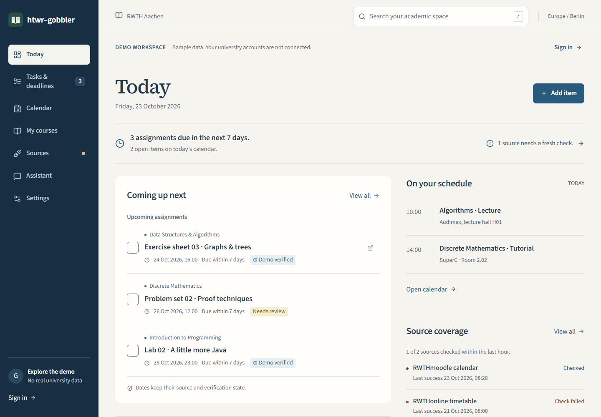

# htwr-gobbler

A calmer academic workspace for RWTH students. React + TypeScript PWA, Hono/Cloudflare Worker, D1 SQLite, and a read-only MCP server. **Working development MVP; university-wide monitoring is not complete.**



## Run locally

Install Node.js 24 and pnpm 11.25.0, then from the repository root:

```sh
pnpm install
```

Copy `.dev.vars.example` to `.dev.vars`. Set `SESSION_SECRET` and `FEED_SECRET` to **different** random values of at least 32 characters. Generate each with:

```sh
node -e "console.log(require('crypto').randomBytes(32).toString('base64url'))"
pnpm db:migrate
pnpm build
pnpm dev
```

Open **http://127.0.0.1:5173**. Use this address rather than `localhost` so the configured write origin matches. The API runs at `http://127.0.0.1:8787`. No Cloudflare account is required for local development. Academic records persist in `.wrangler/state`; that directory and all secrets are ignored by Git. For an existing prepared checkout, do not overwrite `.dev.vars`.

The logged-out view is a clearly labeled, read-only sample workspace. Sign in → **Create an account** opens an empty personal workspace. This is a gobbler account, separate from RWTH SSO. Do not reuse your RWTH password.

## What works

- Responsive Today dashboard, course management, task/event CRUD, completion and dismissal, source URLs, evidence and verification states.
- Assignments are the default Tasks view. Moodle calendar categories identify modules automatically; those modules appear with tasks and calendar deadlines. Ordinary Übung sessions are tutorials, while “ist fällig” entries are assignments. Times remain the exported instants.
- Persistent account-scoped D1 records; another browser/device sees the same records when connected to the same deployed backend. Reload to fetch updates. Local development is intentionally loopback-only.
- One-use account recovery keys generated after password confirmation in Settings. Recovery preserves records and revokes old sessions and MCP tokens. Operators can close registration for a private pilot.
- Day/week/month calendars, course/type filters and search of stored academic entries; Berlin display and DST-aware calendar boundaries.
- `.ics` import/reimport with stable UID deduplication, automatic recognition of repeated file calendars, content-hash updates, meaningful change history, cancellation handling, and retained records when a check fails.
- Allowlisted RWTHmoodle calendar subscription, encrypted URLs, manual checks, bounded retry, source locks and a scheduled Worker handler. Local cron requires an explicit trigger; deployed cron selects the 10 oldest-attempted feeds every 30 minutes.
- Local PDF text extraction with module selection and page evidence, numeric/German month-name dates and explicit date-only candidates. Re-reading the same document date reopens its task; revised documents can update a selected task while retaining its identity and completion state. Every new or revised candidate starts as **needs review**.
- Today prioritizes recent earlier deadlines for open tasks and shows the module and previous/new dates. Date-only tasks remain due today throughout their Berlin calendar day; an unknown cutoff stays explicit.
- Optional, consent-gated OpenAI extraction of pasted/extracted text. An exact source quotation is required. No live provider request was made during development.
- EN/DE/VI navigation and primary labels; light/dark/system theme with account preferences. Detailed help and some forms remain English.
- Foreground browser reminders, permission handling, Berlin quiet hours and per-browser duplicate suppression. **No background Web Push yet.**
- PWA manifest, PNG installation icons, service worker and offline app shell. **Private records are not cached for offline reading.**
- Ten official-SDK MCP tools reading the same API with revocable, expiring, read-only tokens.

Completing a task here **does not submit it to Moodle**.

## Try the import pipeline

1. Create a course in **My courses** and a manual task in **Tasks & deadlines**.
2. In **Sources → Import calendar**, choose `tests/fixtures/calendar.ics`. These are synthetic test events, not real RWTH deadlines.
3. Import it again with **Detect automatically**, even using another source name. Its existing calendar is reused; no duplicate events or change notifications should appear. Partially overlapping exports require selecting the existing file source explicitly.
4. Change one event's date in your own copy and reimport into that source. Its record updates and a change appears on Today.
5. Upload an invalid file into that same source: the failed check remains visible and the old records survive.
6. In **Settings → Review document text**, choose a module and select `tests/fixtures/exercise.pdf`. **Find explicit dates locally**, inspect the page evidence, then **Review and save**. It stays unverified until you confirm against the original. Repeat the review to reopen the same saved date; use the optional existing-task selector for a revised document.

For a real authorized export, sign in to RWTHmoodle yourself, open the calendar's export controls, and either download an `.ics` file or obtain your personal HTTPS export URL. Add the latter with **Connect Moodle calendar**, then **Check now**. Never commit or share that URL; it may grant access to private events.

## Checks

```sh
pnpm test
pnpm build
pnpm exec playwright install chromium
```

On Windows with Edge installed, run `pnpm test:e2e`. On Linux or when using the downloaded browser, set `PLAYWRIGHT_CHANNEL=chromium` before running `pnpm test:e2e`. Tests start local servers if necessary. Browser tests create synthetic accounts and records in the local development database; use a separate checkout if you want isolated test storage. CI runs unit/API tests, build, and Chromium browser/MCP checks.

See [validation](docs/VALIDATION.md), [integration research](docs/INTEGRATIONS.md), [deployment](docs/DEPLOYMENT.md), [security](docs/SECURITY.md), [MCP setup](docs/MCP.md), and [implementation plan](docs/IMPLEMENTATION_PLAN.md).

## Known limits and next work

Calendar checks cover **published calendar entries only**. They do not establish that every exercise PDF, announcement or submission was checked. Full Moodle REST access through RWTH SSO/MFA has not been established. Course discovery, automatic material downloads, university email, Dynexite, Google Calendar writes, Ollama, and background push are not implemented.

Recurring iCalendar events and VTODO task calendars are rejected explicitly; export individual VEVENTs for now. Imports are bounded at 500 events and 2 MB. Missing entries in a rolling export are retained because absence does not reliably prove deletion; explicit cancellations are dismissed. File imports have no automatic polling. Feed freshness is considered current for one hour, so larger installations with more than 10 feeds can show stale checks until a later cron run.

PDF extraction supports text PDFs under 10 MB, at most 20 pages and 20,000 characters. No OCR. Local parsing recognizes dates like `Abgabe bis zum 20.10.2026 um 16:00 Uhr` and `Anmeldung bis 22. Oktober 2026`; other formats and relative dates can be missed. Impossible or ambiguous DST times are skipped; empty results do not prove there are no deadlines. Original PDFs are not stored. External AI requires an operator-configured API model/key and explicit user consent; this may incur provider charges.

No production resources were provisioned or deployed. Authentication includes protected sessions, recovery keys, tenant checks and edge throttling; email ownership verification and a full external security assessment remain release work. Foreground reminders require a confirmed deadline with a known time.
